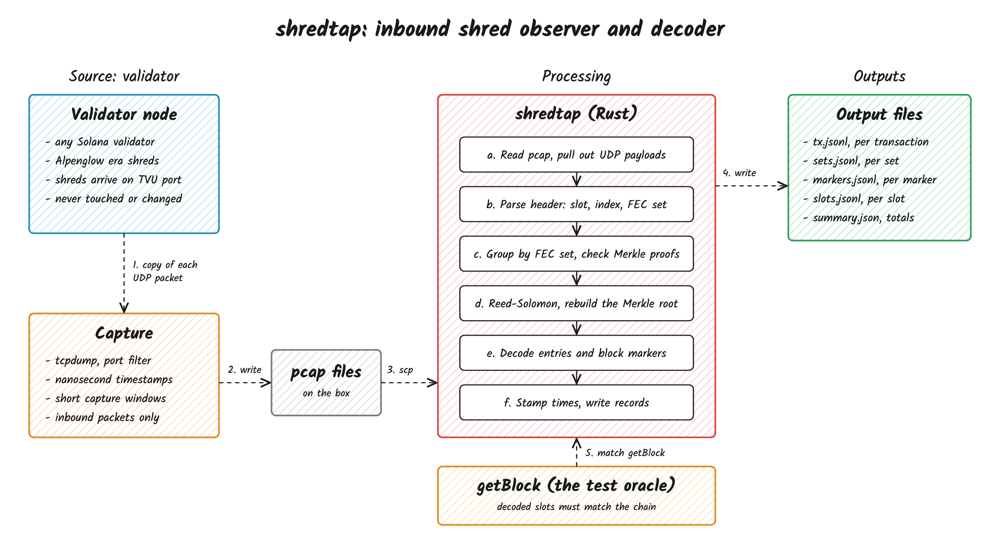
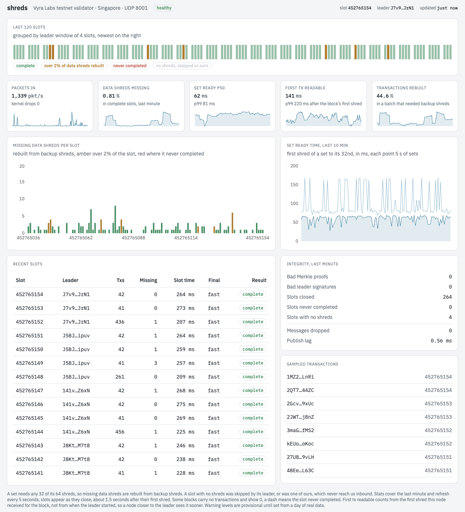

# shredtap

Watch the shreds that reach your Solana validator and rebuild the blocks from them.

shredtap reads the shreds arriving at a node, from a packet capture or live from the network interface. It puts the FEC sets back together, rebuilds missing pieces with Reed-Solomon and decodes every transaction, with the nanosecond time its shreds arrived. It only reads. It never sends anything to the cluster and never touches the validator.

Live from the Vyra Labs testnet validator in Singapore: [shreds.vyralabs.fun](https://shreds.vyralabs.fun)

The shred reading itself lives in [shred-core](https://github.com/vyralabshq/shred-core): parsing shreds, Merkle proofs and leader signatures, FEC sets and Reed-Solomon, and decoding entries and the block footer. shredtap runs it on a capture or a live interface, times every step and publishes what it finds.



## What it checks

Blocks rebuilt from captured shreds match the same blocks fetched with getBlock, transaction for transaction.

Every shred's Merkle proof is checked against its FEC set's root, and every set rebuilt with Reed-Solomon is checked by building its whole Merkle tree again. Given the leader schedule, every set must also carry its slot leader's signature over that root. A changed or forged shred is dropped and counted.

Every transaction also says whether its bytes came over the wire. It is marked rebuilt when one of its data shreds never reached the node by the slot's deadline, so part of it exists only because Reed-Solomon computed it.

> Without a leader schedule, signatures are not checked and the first shred of a set decides its root. Only feed it traffic captured on your own node.

## Build

Needs Rust 1.89 or newer.

```sh
git clone https://github.com/jkrishnad/shred-tap
cd shred-tap
cargo build --release
```

Cargo fetches shred-core from GitHub at tag `v0.2.0`. That builds `shredtap decode`. Two features add the live parts.

- `live` adds `shredtap live`, reading packets straight from a network interface. Needs libpcap.
- `nats` adds `--nats`, publishing every event to a NATS server.

```sh
cargo build --release --features live,nats
```

## Decode a capture

Capture shreds on the node with tcpdump, using nanosecond timestamps.

```sh
sudo timeout 60 tcpdump -i <interface> -nn -s 1300 -B 65536 \
  --time-stamp-precision=nano -w shreds.pcap \
  'udp and dst host <node ip> and (udp[4:2] = 1211 or udp[4:2] = 1236)'
```

Save the leader schedule for the epoch of the capture, then decode it.

```sh
solana leader-schedule -ut --epoch <epoch> > leaders.txt
shredtap decode shreds.pcap --out out --leader-schedule leaders.txt
```

Pass `--leader-schedule` again to load more than one epoch. Use `-` instead of a file to decode a live tcpdump pipe, and `--out -` to stream every event to stdout. A capture holds your peers' IP addresses, so keep it private.

### Output

1. `tx.jsonl`, every transaction with its arrival times and whether it was rebuilt
2. `sets.jsonl`, every FEC set, how many data shreds it had when decoded and which never arrived
3. `markers.jsonl`, block header and footer markers
4. `slots.jsonl`, every slot and how it ended
5. `summary.json`, totals for duplicates, late shreds, bad proofs and signatures, lost sets, recovery and rebuilt transactions

A slot's lines are written when it closes, 1.45 s after its first shred with 200 ms slots, so data shreds that arrive late still count as arrived.

## Run it live

```sh
shredtap live --interface <interface> --nats 127.0.0.1:4222 \
  --leader-schedule-dir /var/lib/shredtap/leaders
```

`live` takes a passive copy of every packet on the interface, the same way tcpdump does, and needs `CAP_NET_RAW` and `CAP_NET_ADMIN` instead of root. `--leader-schedule-dir` holds one schedule file per epoch and is read again whenever a file in it changes, so a run carries on across epochs.

With `--nats` every event goes to a NATS server on these subjects.

| Subject         | What                                                                                         | Kept          |
| --------------- | -------------------------------------------------------------------------------------------- | ------------- |
| `shred.slot`    | every slot and how it ended                                                                  | stored 3 days |
| `shred.stats`   | a rollup of the last minute, every 5 s                                                       | stored 3 days |
| `shred.tx`      | every transaction                                                                            | live only     |
| `shred.public`  | a small summary per slot plus the rollups, about 2 KB a second                               | live only     |
| `shred.history` | the last 150 summaries, 10 minutes of rollups and the newest samples, refreshed every second | latest only   |

The capture thread never waits for NATS. Events wait on a bounded queue, and a publisher that falls behind drops transactions first and counts what it dropped in the next rollup.

`deploy/` holds the setup the testnet node runs: systemd units for shredtap and NATS, the NATS config and a timer that keeps the leader schedule one epoch ahead. shredtap runs as the validator's user at the lowest CPU priority, capped at 512 MB.

## The page

`web/` is the page at [shreds.vyralabs.fun](https://shreds.vyralabs.fun), a static Next.js export on Vercel. The browser connects to the NATS websocket through Caddy at `/feed`, as a public user that may only read `shred.public` and the `shred.history` snapshot. Every transaction, set and marker stays on the node.

It shows the last 120 slots, missing data shreds per slot, set ready time, integrity counters for the last minute, recent slots and sampled transactions that link to the explorer. Hovering a panel pauses it.



```sh
cd web
npm install
npm run dev
```

Without `NEXT_PUBLIC_FEED_URL` the page connects to `ws://localhost:4280`, the node's NATS websocket through an SSH tunnel.

## What it showed

From a quiet hour on testnet, with a node in Singapore and 200 ms slots.

1. A FEC set can be rebuilt about 60 ms after its first shred arrives.
2. A whole block takes about 261 ms from its first shred, longer than a slot.
3. 30% of FEC sets never got all 32 data shreds, so Reed-Solomon is used all the time.

During Anza's load test on testnet on 2026-10-15, with 7-10k shreds a second and slots of up to 3,900 transactions:

1. shredtap live used under half a CPU core.
2. The first transaction of a slot was readable about 84-146 ms after its first shred, at p50.
3. No shred failed a Merkle proof or leader signature check.
4. 4-11% of data shreds never arrived from upstream, and Reed-Solomon filled them in.
